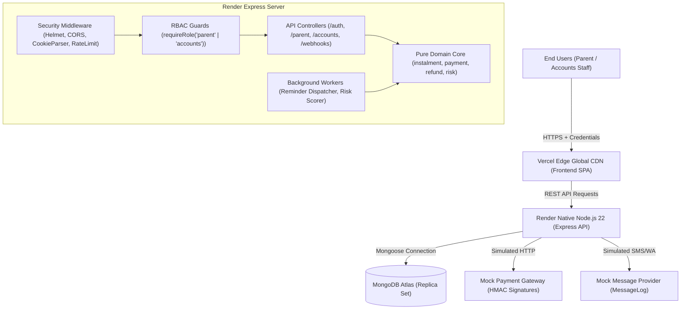
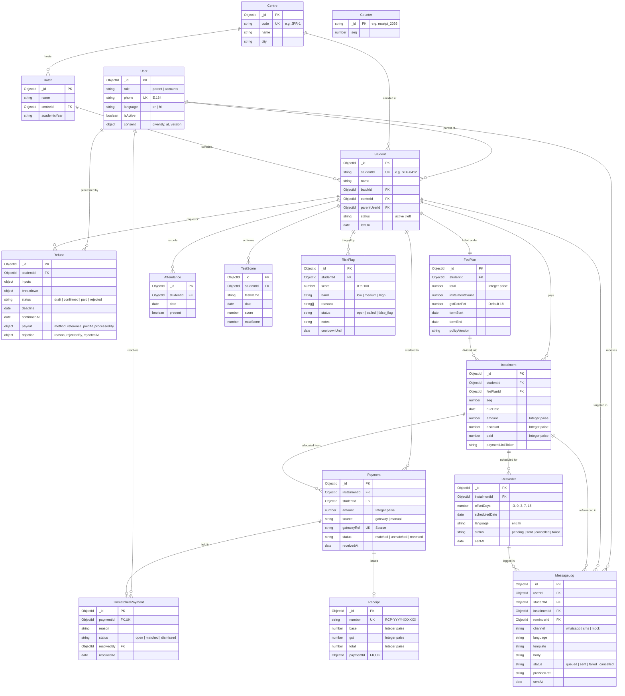
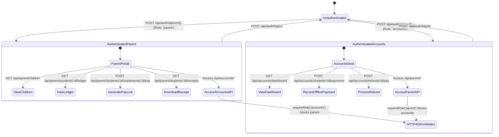
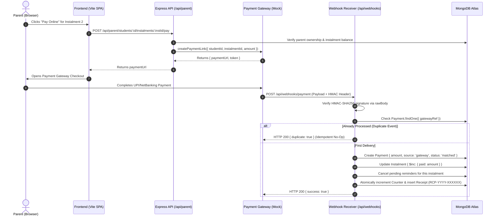
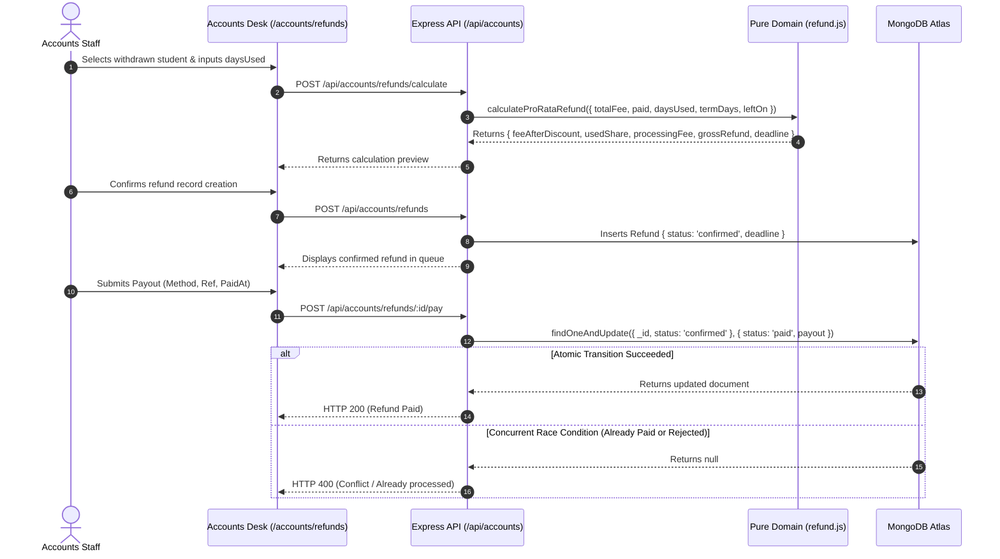

# FEETrack — Technical Design Document (TDD)

**System:** FEETrack Coaching Fee Tracking & Parent Portal  
**Document Version:** 1.0.0  
**Status:** Approved Architecture (Phases 1–7.2 Complete)  
**Date:** 2026-11-09  
**GitHub Repository:** `https://github.com/PrafullShinde28/Coaching_Fee_Management_System.git`  
**Live Application URL:** *No live cloud deployment is currently provided. The application is configured and verified for native deployment to Render (backend API) and Vercel (frontend SPA) with MongoDB Atlas, but has not yet been provisioned on public commercial domains.*

---

## 1. Executive Summary and Problem Statement

### 1.1 Client Background
FEETrack is an enterprise-grade coaching fee management platform and parent engagement portal designed for large-scale multi-centre coaching institutes. The operational profile modeled by the system reflects:
- **Footprint:** 4 branch centres across Jaipur (Jaipur Central, Vaishali Nagar, Malviya Nagar, Mansarovar).
- **Scale:** ~2,600 enrolled students across medical (NEET) and engineering (JEE) preparatory batches.
- **Staffing:** ~140 faculty members, front-office executives, accountants, and academic counsellors.
- **Financial Volume:** Average annual tuition of ₹1.2 lakh per student, structured across 3–4 scheduled instalments, yielding tens of crores in annual collections.

### 1.2 Core Operational Deficiencies
Prior to FEETrack, fee operations relied on fragmented spreadsheets, disconnected POS machines, and paper receipts, creating four critical vulnerabilities:
1. **Reconciliation Lag:** Online bank transfers and UPI remittances frequently arrived with truncated or missing student roll numbers, creating an untracked suspense account queue exceeding lakhs of rupees.
2. **Cash Leakage & Delayed Receipts:** Front-desk cash collections required immediate, tamper-evident GST receipts with sequential numbers to prevent administrative fraud.
3. **Dropout & Default Blindspots:** Student withdrawals frequently correlated with early fee arrears, unexplained attendance declines, and deteriorating test scores. Counsellors lacked a unified triage desk to detect dropouts prior to departure.
4. **Disputed Withdrawal Settlements:** When students withdrew mid-session, subjective manual refund calculations triggered contentious disputes. An auditable, pro-rata refund desk with statutory GST deductions and rigid departure deadlines was needed.

### 1.3 System Solution
FEETrack resolves these operational bottlenecks through:
- A high-security, bilingual (English & Hindi) **Parent Portal** enabling instant fee ledger review, online payments, and GST receipt downloads.
- A desktop-optimized **Accounts Desk** offering multi-centre aggregation, offline payment recording, unmatched payment reconciliation, atomic pro-rata refund processing, and automated fee reminders.
- A multi-signal **Dropout-Risk Triage Engine** operating under strict pastoral decoupling (academic intervention without financial penalties).

---

## 2. Scope, Goals and Non-Goals

### 2.1 Project Scope
The system encompasses end-to-end fee lifecycle management, parent mobile engagement, and operational compliance.

```
+-----------------------------------------------------------------------------------+
| IN SCOPE (Phases 1–7)                                                             |
| - OTP-based authentication via httpOnly secure cookies for Parents & Accounts     |
| - First-login parental consent tracking with policy versioning                    |
| - Multi-child ledger inspection with derived instalment statuses                  |
| - Payment link generation with mock gateway & HMAC-SHA256 webhook allocation      |
| - FIFO and targeted instalment credit allocation with non-spillover rules         |
| - Monotonic sequential GST receipt issuance (RCP-YYYY-XXXXXX) with 18% math       |
| - Automated 5-offset reminder engine (T-3, T, T+3, T+7, T+15) with live balance re-check|
| - Multi-signal dropout-risk scoring (0–100) with 30-day false-flag cooldown       |
| - Pro-rata refund calculator with 5% processing fee cap and 10-day deadline       |
| - Accounts desk: centre filtering, offline payments, unmatched queue, CSV export  |
+-----------------------------------------------------------------------------------+
```

### 2.2 System Goals
- **Financial Precision:** Absolute elimination of IEEE-754 floating-point errors by storing and computing all monetary values in integer **paise** ($1\text{ INR} = 100\text{ paise}$).
- **Concurrency Safety:** Guaranteeing that simultaneous payout or rejection requests on a refund record cannot result in duplicate payouts or overwritten audits.
- **Zero Client-Side Token Footprint:** Elimination of JWT exposure to XSS attacks by avoiding browser `localStorage` and `sessionStorage`.
- **Bilingual Accessibility:** Complete English and Hindi parity across all UI elements, status labels, and SMS/WhatsApp reminder templates.

### 2.3 Non-Goals (Explicit Exclusions)
- **Live Monetary Processing:** This version does not connect to live banking networks or live payment aggregator credentials (runs on a verified `MockPaymentGateway`).
- **Live Telecom Dispatch:** Does not send real-world SMS or WhatsApp messages (runs on a verified `MockMessageProvider` logging to `MessageLog`).
- **Real-Time Financial Penalties:** The dropout-risk engine is strictly decoupled from financial operations; it does not block students, assess late fines, or send automated debt collection demands.
- **Enterprise ERP / LMS:** Does not provide timetable scheduling, online video classes, or human resource payroll management.

---

## 3. Requirements and Explicit Assumptions

### 3.1 Hard Requirements vs. Engineering Assumptions

| Identifier | Domain | Classification | Description |
|---|---|---|---|
| **REQ-01** | Security | **Hard Requirement** | Zero JWTs in client storage; sessions must use `httpOnly`, `SameSite=Lax`, `Secure` cookies. |
| **REQ-02** | Security | **Hard Requirement** | Bidirectional RBAC: Parent accounts cannot access Accounts APIs (HTTP 403); Accounts staff cannot access Parent APIs. |
| **REQ-03** | Domain | **Hard Requirement** | Payments targeted to an instalment must never spill into another instalment; unallocated surplus remains in holding. |
| **REQ-04** | Tax / Legal | **Hard Requirement** | GST receipts must be monotonically sequential (`RCP-YYYY-XXXXXX`) and guarantee $\text{base} + \text{gst} \equiv \text{total}$. |
| **REQ-05** | Security | **Hard Requirement** | Payment webhooks must be verified using HMAC-SHA256 over raw request body buffers using constant-time equality. |
| **REQ-06** | Security | **Hard Requirement** | CSV reports must neutralize formula injection attacks on cells starting with `=`, `+`, `-`, `@`, `\t`, `\r`. |
| **ASSUMP-01**| Financial | **Engineering Assumption** | All monetary amounts are integer paise. Proportional division uses round-half-up integer math. |
| **ASSUMP-02**| Temporal | **Engineering Assumption** | Business operations evaluate against an injectable clock (`DEMO_TODAY`, default `2026-11-02` in demo mode). |
| **ASSUMP-03**| Legal | **Engineering Assumption** | Pro-rata refund formula: $\text{netRefund} = \max(0, \text{paid} - \text{usedShare} - \text{processingFee})$, subject to institute legal review. |
| **ASSUMP-04**| Legal | **Engineering Assumption** | Processing fee is $5\%$ of pre-discount total fee, capped at $\text{\rupee}5,000$ ($500\,000\text{ paise}$). |
| **ASSUMP-05**| Academic | **Engineering Assumption** | Refund withdrawal window is strictly enforced as $\text{leftOn} + 10\text{ calendar days}$. |
| **ASSUMP-06**| Pastoral | **Engineering Assumption** | Risk scoring heuristic: Payment (50), Attendance (30), Test Score (20) points. Max score 100. |
| **ASSUMP-07**| Identity | **Engineering Assumption** | All 53 seed students, phone numbers (`+9199000000xx`), and staff are synthetic demo records. |

---

## 4. Technology Stack and Architecture Decisions

### 4.1 Technology Matrix

| Tier | Technology | Version | Architectural Rationale |
|---|---|---|---|
| **Frontend** | React | `18.3.1` | Component-driven UI with declarative state hydration. |
| **Bundler** | Vite | `6.0.7` | Sub-second HMR and optimized production Rollup bundling. |
| **Routing** | React Router DOM | `6.28.1` | Declarative client-side routing with role-based route guards. |
| **Styling** | Plain CSS Variables | Native CSS | Custom design token system (`tokens.css`); zero runtime CSS-in-JS overhead. |
| **Localization** | `react-i18next` | `15.4.0` | Zero-flicker bilingual switching with 100% dictionary key parity. |
| **Backend** | Node.js | `22 LTS` | Native ESM support, high I/O throughput, built-in `node:test` runner. |
| **Framework** | Express.js | `4.21.2` | Unopinionated, robust REST middleware pipeline. |
| **Database** | MongoDB Atlas | `7.0+` | Scalable document store with multi-document ACID transactions and atomic operators. |
| **ODM** | Mongoose | `8.9.5` | Schema validation, strong typing, compound indexes, and lifecycle hooks. |
| **Validation** | Zod | `3.24.1` | Compile-time and runtime type validation on 100% of mutation payloads. |
| **Security** | Helmet | `8.0.0` | Comprehensive HTTP security header enforcement (HSTS, CSP, X-Frame-Options). |
| **Scheduling**| `node-cron` | `4.6.0` | Native in-process cron daemon for automated reminders and risk scoring. |
| **Testing** | `node:test` | Built-in | Zero-dependency native test harness with sub-second execution speeds. |

### 4.2 Key Architectural Decisions

#### Decision 1: Pure Domain Layer Decoupling
Business logic is decoupled into pure JavaScript functions in `server/src/domain/`:
- `instalment.js`: Derives instalment status (`paid`, `part_paid`, `overdue`, `due_soon`, `upcoming`) and overdue days.
- `payment-allocation.js`: Computes FIFO and targeted credit allocations.
- `refund.js`: Computes pro-rata refunds, statutory GST splits, and deadline enforcement.
- `risk-scorer.js`: Computes multi-signal weighted dropout scores.

*Rationale:* Domain pure functions take plain objects, return plain objects, and possess zero database or Express dependencies, enabling instantaneous unit testing and provable determinism.

#### Decision 2: HttpOnly Cookie Sessions over Bearer Tokens
Instead of storing JWTs in `localStorage` (vulnerable to XSS extraction), authentication issues an `httpOnly`, `SameSite=Lax`, `Secure` cookie named `fee_portal_session`. All API requests enforce `credentials: 'include'`.

#### Decision 3: Atomic Status Transitions for Financial Operations
To prevent race conditions during refund payouts, status transitions utilize atomic database modifications:
```javascript
const updatedRefund = await Refund.findOneAndUpdate(
  { _id: refundId, status: 'confirmed' },
  { $set: { status: 'paid', payout: payoutData } },
  { new: true }
);
if (!updatedRefund) {
  return res.status(400).json({ error: 'Refund has already been processed or is not in confirmed state' });
}
```

---

## 5. System Architecture and Component Responsibilities

### 5.1 High-Level Component Topology



### 5.2 Component Responsibilities

| Component | Physical Path | Primary Responsibilities |
|---|---|---|
| **App Entrypoint** | `server/src/index.js` | Initializes database connection, bootstraps cron schedulers, binds HTTP server to `0.0.0.0:${PORT}`, and registers `SIGTERM`/`SIGINT` graceful shutdown hooks. |
| **Express Pipeline** | `server/src/app.js` | Configures Helmet, CORS allowlisting, raw buffer body parser, cookie parser, route mounting, and central Zod/500 error handlers. |
| **Authentication Router** | `server/src/routes/auth.js` | Handles OTP generation, verification, cookie issuance, parental consent, profile hydration (`/api/auth/me`), and logout. |
| **Parent Router** | `server/src/routes/parent.js` | Scopes data strictly to authenticated parents (`parentUserId`); exposes children lists, fee ledgers, payment link generation, and receipt downloads. |
| **Accounts Router** | `server/src/routes/accounts.js` | Exposes dashboard metrics, centre filters, student directory, offline payment recording, unmatched queues, refund calculations/payouts, and CSV exports. |
| **Webhook Receiver** | `server/src/routes/webhook.js` | Validates payment gateway HMAC-SHA256 signatures, prevents duplicate processing via unique gateway references, and allocates credits. |
| **Receipt Service** | `server/src/services/receipt.js` | Atomically increments yearly counters and generates sequential GST receipts (`RCP-YYYY-XXXXXX`). |
| **Reminder Worker** | `server/src/services/reminderService.js` | Evaluates $T-3$ to $T+15$ reminder offsets, re-checks live balances, dispatches bilingual templates, and writes audit records to `MessageLog`. |
| **Risk Scorer Worker**| `server/src/services/riskService.js` | Computes nightly multi-signal dropout risk, enforces 30-day cooldowns, and populates the counsellor triage desk. |

---

## 6. Database Design and Entity Relationships

### 6.1 Database Architecture & Model Inventory
The persistence tier is implemented using **16 distinct Mongoose models** mapping directly to **16 MongoDB collections**, accompanied by **3 embedded subdocument schemas** (`consentSchema`, `payoutSchema`, `rejectionSchema`) that do not generate separate collections.

| Model Name | Underlying Schema | MongoDB Collection | Primary Domain Responsibility |
|---|---|---|---|
| **`User`** | `userSchema` | `users` | System user identities (`parent`, `accounts`), phone credentials, language preference (`en`, `hi`), and embedded `consentSchema`. |
| **`Centre`** | `centreSchema` | `centres` | Physical institute branch locations across Jaipur (`code`, `name`, `city`). |
| **`Batch`** | `batchSchema` | `batches` | Academic course batches (e.g. JEE/NEET Morning/Evening) linked to specific centres. |
| **`Student`** | `studentSchema` | `students` | Enrolled student profiles, roll numbers (`studentId`), batch/centre links, parent link, and status (`active`, `left`). |
| **`FeePlan`** | `feePlanSchema` | `feeplans` | Annual tuition fee structure, total tuition, instalment count, term dates, and refund policy version. |
| **`Instalment`** | `instalmentSchema` | `instalments` | Scheduled fee milestone, due date, amount, scholarship discount, paid amount, and payment link token. |
| **`Payment`** | `paymentSchema` | `payments` | Financial transaction record, payment source (`gateway`, `manual`), gateway reference, and status (`matched`, `unmatched`, `reversed`). |
| **`Receipt`** | `receiptSchema` | `receipts` | Immutable GST tax receipt (`RCP-YYYY-XXXXXX`), base amount, inclusive GST amount, total, and 1:1 payment link. |
| **`Reminder`** | `reminderSchema` | `reminders` | Scheduled fee reminder milestone (-3, 0, 3, 7, 15 days), scheduled date, language, and dispatch status. |
| **`Refund`** | `refundSchema` | `refunds` | Mid-session withdrawal refund record, pro-rata calculation breakdown, deadline, and embedded `payoutSchema` / `rejectionSchema`. |
| **`UnmatchedPayment`** | `unmatchedPaymentSchema` | `unmatchedpayments` | Holding queue for unallocated bank remittances, resolution status, and staff audit attribution. |
| **`Attendance`** | `attendanceSchema` | `attendances` | Daily student attendance records (present/absent) powering the dropout-risk heuristic. |
| **`TestScore`** | `testScoreSchema` | `testscores` | Internal mock exam scores and maximum marks powering the academic risk trajectory. |
| **`RiskFlag`** | `riskFlagSchema` | `riskflags` | High-risk triage flag, composite score (0–100), explainable diagnostic reasons, status, notes, and 30-day cooldown. |
| **`MessageLog`** | `messageLogSchema` | `messagelogs` | Audit trail of all outbound SMS/WhatsApp reminder notifications, channel, template, rendered body, and provider status. |
| **`Counter`** | `counterSchema` | `counters` | Monotonic atomic sequence generator for yearly sequential receipt numbers (`receipt_YYYY`). |

#### Embedded Subdocument Schemas (No Independent Collections)
1. **`consentSchema`:** `{ givenBy: ObjectId, at: Date, version: String }` (Embedded in `User`).
2. **`payoutSchema`:** `{ method: String, reference: String, paidAt: Date, processedBy: ObjectId, notes: String }` (Embedded in `Refund`).
3. **`rejectionSchema`:** `{ reason: String, rejectedBy: ObjectId, rejectedAt: Date }` (Embedded in `Refund`).

---

### 6.2 Entity Relationship Diagram (ERD)



### 6.3 Key Database Indexes & Concurrency Controls
1. **Instalments:** `{ studentId: 1, seq: 1 }` (Unique compound index preventing duplicate instalment sequencing).
2. **Payments:** `{ gatewayRef: 1 }` (Sparse unique index preventing duplicate webhook credit allocations).
3. **Reminders:** `{ instalmentId: 1, offsetDays: 1 }` (Unique compound index guaranteeing reminder idempotency).
4. **Attendance:** `{ studentId: 1, date: 1 }` (Unique compound index preventing double attendance marking).
5. **Receipt Counters:** Atomic monotonic counter upserts on `Counter` (`{ _id: 'receipt_2026' }`) using `$inc: { seq: 1 }`.

---

## 7. Authentication, Authorization and Security

### 7.1 Cookie Lifecycle & Cross-Origin Security
- **Cookie Flags:** `httpOnly: true`, `secure: process.env.NODE_ENV === 'production'`, `sameSite: 'lax'`, `maxAge: 28800000` (8 hours), `path: '/'`.
- **Domain Scoping:** Configured via optional `COOKIE_DOMAIN`. When set (e.g. `COOKIE_DOMAIN=.feetrack.in`), both `portal.feetrack.in` and `api.feetrack.in` share the cookie across same-site subdomains. When omitted, host-only scoping applies.
- **CORS Allowlisting:** `cors({ origin: env.CLIENT_ORIGIN, credentials: true })`. Wildcards are prohibited.

### 7.2 Role-Based Access Control (RBAC) State Machine



### 7.3 OWASP Security Implementations
1. **CSV Formula Injection Mitigation:** All CSV report exports run through `server/src/utils/csvSanitizer.js`. Any cell beginning with `=`, `+`, `-`, `@`, `\t`, or `\r` (even after stripping leading whitespace) is prepended with a single quotation mark (`'`).
2. **Webhook Timing-Attack Defense:** Webhook verification compares the computed HMAC-SHA256 digest against the header signature using `crypto.timingSafeEqual(Buffer.from(sig), Buffer.from(expectedSig))`.
3. **Rate Limiting:** OTP generation is throttled to 5 requests per 60-second window per client IP/phone using `express-rate-limit`.

---

## 8. Main End-to-End Workflows

### 8.1 Parent Login and Fee Viewing Workflow
1. Parent enters phone number (`+919900000041`) at `/login`.
2. Backend validates E.164 phone regex, generates a 6-digit OTP, stores it in memory with a 5-minute TTL, and dispatches via `otpProvider`.
3. Parent submits OTP. Backend validates code, signs a 24-hour JWT containing `{ sub: user._id, role: user.role }`, and sets `fee_portal_session` cookie.
4. Client hydrates session via `GET /api/auth/me`. If first login, the Consent Modal is presented (`POST /api/auth/consent`).
5. Client requests `GET /api/parent/children`. Backend queries `Student.find({ parentUserId: req.user._id })`, derives instalment statuses, and returns child cards.

### 8.2 Payment and Webhook Processing Workflow



### 8.3 Receipt Generation Workflow
1. Triggered immediately upon payment confirmation (online webhook or manual collection).
2. Inclusive GST calculation splits amount ($18\%$ inclusive):
   $$\text{gst} = \text{roundDiv}(\text{amount} \times 18, 118), \quad \text{base} = \text{amount} - \text{gst}$$
3. Sequence generator atomically executes `Counter.findOneAndUpdate({ _id: 'receipt_2026' }, { $inc: { seq: 1 } }, { upsert: true, new: true })`.
4. Formats receipt number: `RCP-2026-` padded with 6 digits (e.g. `RCP-2026-000042`).
5. Inserts immutable `Receipt` document linked by unique `paymentId`.

### 8.4 Accounts Dashboard and Manual Payment Collection
1. Accounts staff visits `/accounts/dashboard`. API aggregates total tuition, total collected, overdue arrears, active students, and batch summaries.
2. For an in-person cash/cheque payment, staff selects student, enters amount, payment mode, and reference.
3. Backend runs `planPaymentAllocation`. If untargeted, credits oldest due instalment first (FIFO).
4. Updates instalment `paid` balance, generates sequential GST receipt, and returns receipt modal to staff for instant printing.

### 8.5 Unmatched Payment Handling
1. Bank remittances arriving without valid student references enter `Payment` with `status: 'unmatched'` and create an `UnmatchedPayment` record with `status: 'open'`.
2. Accounts staff inspects `/accounts/unmatched`.
3. Staff can either:
   - **Match to Student:** Staff searches student roll number; backend executes FIFO credit allocation, marks payment `matched`, and resolves queue item.
   - **Dismiss:** Staff dismisses erroneous or duplicate bank deposits with a mandatory audit reason.

### 8.6 Refund Processing Workflow



### 8.7 Fee Reminder Engine Workflow
1. Schedulers trigger daily at 09:00 AM IST (`server/src/services/reminderService.js`).
2. Schedulers scan active instalments against business date `clock.today()`.
3. For eligible instalments at offsets $T-3, T, T+3, T+7, T+15$, verifies if `(instalmentId, offsetDays)` exists in `Reminder`.
4. If missing, inserts `Reminder { status: 'pending' }`.
5. Pre-dispatch check: Immediately re-queries instalment balance. If zero or student withdrew, marks `cancelled`.
6. Dispatches bilingual template via `messageProvider` and records timestamp and status to `MessageLog`.

### 8.8 AI-Assisted Dropout-Risk Detection & Counsellor Follow-up
1. Schedulers trigger nightly at 02:00 AM (`server/src/services/riskService.js`).
2. Evaluates all active students across payment delays, attendance drops, and test score drops.
3. If aggregate score $\ge 65$ (High Risk), checks `cooldownUntil` date on existing flags.
4. If cooldown expired and no open flag exists, creates `RiskFlag { score, band: 'high', reasons, status: 'open' }`.
5. Counsellor reviews `/accounts/risk`, places pastoral check-in call, and updates flag to `called` or `false_flag` (triggering 30-day cooldown).

---

## 9. AI/Automation Design, Explainability and False-Positive Handling

### 9.1 Multi-Signal Additive Heuristic
The dropout-risk engine is a transparent, explainable heuristic scoring model operating on a bounded $0$ to $100$ scale:

$$\text{RiskScore} = \min\left(100, \text{Score}_{\text{payment}} + \text{Score}_{\text{attendance}} + \text{Score}_{\text{test}}\right)$$

```
+-----------------------------------------------------------------------------------+
| SIGNAL WEIGHTING BREAKDOWN (Max 100 Points)                                       |
|                                                                                   |
| 1. Payment Signals (Max 50 Points):                                               |
|    - Instalment Overdue > 30 Days: +35 points                                     |
|    - Instalment Overdue 15–30 Days: +20 points                                    |
|    - Part-Paid with remaining overdue balance: +15 points                         |
|    - Historical repeated defaults (>1 overdue instalment): +10 points             |
|                                                                                   |
| 2. Attendance Trajectory (Max 30 Points):                                        |
|    - 30-Day Attendance Rate < 60%: +30 points                                     |
|    - 30-Day Attendance Rate 60%–75%: +20 points                                   |
|    - Unexplained consecutive absences (>3 sessions): +10 points                  |
|                                                                                   |
| 3. Academic Test Performance (Max 20 Points):                                     |
|    - Severe downward trajectory across last 3 tests (>20% drop): +20 points       |
|    - Moderate downward trajectory (10%–20% drop): +10 points                      |
|    - Test absenteeism (missed scheduled internal mock): +10 points                |
+-----------------------------------------------------------------------------------+
```

### 9.2 Explainability Guarantees
The scorer generates human-readable diagnostic strings returned alongside the numeric score:
- *"Instalment overdue by 23 days with unpaid balance of ₹15,000"*
- *"30-day attendance dropped to 64% (3 consecutive missed sessions)"*
- *"Test score trajectory declined by 22% over last 3 mocks"*

### 9.3 False-Positive Mitigation & 30-Day Cooldown
If a student was flagged due to temporary approved medical leave or sanctioned fee delay:
1. Counsellor marks flag as `false_flag` and enters explanatory notes (e.g. *"Student hospitalized for jaundice; medical certificate provided"*).
2. The system sets `cooldownUntil = clock.today() + 30 days`.
3. The nightly risk engine checks `student.cooldownUntil`. Any automated flag generation for this student is suppressed until the cooldown window elapses.

---

## 10. UI/UX Design Decisions and Responsive Screens

### 10.1 Design Token Architecture
All visual presentation is controlled via CSS custom properties in `client/src/tokens.css`:
- **Colors:** Primary Navy (`#1e3a8a`), Secondary Amber (`#d97706`), Success Emerald (`#059669`), Danger Ruby (`#dc2626`), Surface Gray (`#f8fafc`).
- **Typography:** System font stack (`system-ui, -apple-system, 'Segoe UI', Roboto, sans-serif`) with explicit font-size scales (`--font-xs` to `--font-2xl`).
- **Spacing:** Geometric 4px spacing grid (`--space-1: 4px` to `--space-12: 48px`).

### 10.2 Responsive Viewport Targets
- **1440px (Desktop):** Two-column split ledgers on parent portal; full horizontal data tables with column sorting and filters on accounts desk.
- **768px (Tablet):** Collapsible sidebar layout, horizontal scrolling data tables with sticky student ID columns.
- **375px (Mobile):** Single-column stacked cards, bottom navigation bar (`AccountsMobileNav`), drawer navigation for parents, touch targets $\ge 44\text{px}$.

---

## 11. Testing Strategy and Verified Results

### 11.1 Multi-Tier Test Harness

```
+---------------------------------------------------------------------------------+
| TIER 1: ISOLATED SEED IDEMPOTENCY TEST                                          |
| Target: server/src/scripts/seed-test.js                                         |
| Execution: Ephemeral MongoMemoryServer runs Seed Run 1 & Run 2.                 |
| Verification: Exact collection counts match; sample student records verified.   |
+---------------------------------------------------------------------------------+
                                       |
                                       v
+---------------------------------------------------------------------------------+
| TIER 2: SERVER DOMAIN & INTEGRATION SUITE (82 Tests)                             |
| Target: server/test/*.js (6 test files using node:test)                         |
| Scope: Pure math, auth cookies, HMAC webhooks, receipts, reminders, risk desk,  |
|        atomic refund concurrency, and CSV sanitization.                         |
+---------------------------------------------------------------------------------+
                                       |
                                       v
+---------------------------------------------------------------------------------+
| TIER 3: CLIENT UNIT & SECURITY SUITE (17 Tests)                                 |
| Target: client/test/*.js (2 test files using node:test)                         |
| Scope: Formatters, design tokens, EN/HI parity, API credentials, zero-token scan|
+---------------------------------------------------------------------------------+
                                       |
                                       v
+---------------------------------------------------------------------------------+
| TIER 4: BROWSER HEADLESS CDP VERIFICATION (13 Checks)                           |
| Target: scripts/verify-browser-phase6.js                                        |
| Scope: Live Chrome driving OTP login, student search, manual payment modal,     |
|        refund calculation, responsive layouts (1440px/768px/375px), Hindi toggle|
+---------------------------------------------------------------------------------+
```

### 11.2 Historical Verified Metrics

| Test Suite Category | Runner / Engine | Number of Checks | Pass Rate | Execution Duration |
|---|---|---|---|---|
| **Server Test Suite** | Node.js `node:test` | **82 passing tests** | 100% | 11.3s |
| **Client Test Suite** | Node.js `node:test` | **17 passing tests** | 100% | 272ms |
| **Browser E2E Verification** | Chrome DevTools Protocol | **13 verified checks** | 100% | 38.5s (0 console errors) |
| **Total Automated Checks** | Multi-Tier Harness | **112 verified checks** | 100% | Complete Regression Pass |

*Categorization Notice: The 112 checks comprise 82 server tests, 17 client tests, and 13 browser CDP checks; they are not 112 unit tests.*

---

## 12. Limitations, Risks and Future Improvements

### 12.1 Current System Limitations
1. **Mock Integrations:** Payment links, HMAC webhooks, OTP codes, and WhatsApp reminders run against simulated in-memory adapters.
2. **Single-Instance Cron Schedulers:** Schedulers execute in-process via `node-cron`. If backend containers are scaled horizontally without a distributed lock (e.g. Redlock or MongoDB collection lock), reminder evaluations would trigger redundantly.
3. **Cross-Site Vendor Cookies:** When deployed across different vendor domains (`.vercel.app` vs `.onrender.com`), browsers block `SameSite=Lax` cookies on asynchronous fetch calls unless a shared apex domain (`.feetrack.in`) is provisioned.

### 12.2 Risk Register & Mitigations

| Risk | Probability | Severity | Architectural Mitigation |
|---|---|---|---|
| **Double Refund Payout** | Low | High | Atomic `findOneAndUpdate({ _id, status: 'confirmed' })` ensures second concurrent request receives HTTP 400. |
| **Duplicate Webhook Allocations** | Medium | High | Sparse unique index on `Payment.gatewayRef` causes duplicate webhook deliveries to exit idempotently. |
| **Formula Injection in Excel** | Medium | Medium | OWASP CSV sanitizer strips whitespace and prepends `'` to dangerous mathematical operators. |
| **Unapproved Policy Disputes** | High | Medium | UI and TDD explicitly label the pro-rata refund formula as an assumed policy pending institute legal sign-off. |

### 12.3 Future Roadmap (Post-Release)
1. **Commercial Aggregator Adapter:** Implement concrete `RazorpayPaymentGateway` and `CashfreePaymentGateway` satisfying the standard interface.
2. **DLT-Approved Telecom Adapter:** Integrate `GupshupMessageProvider` or `TwilioMessageProvider` with Indian telecom DLT template IDs.
3. **Distributed Worker Process:** Decouple `node-cron` schedulers from the web API into a dedicated singleton worker service (`worker.js`).
